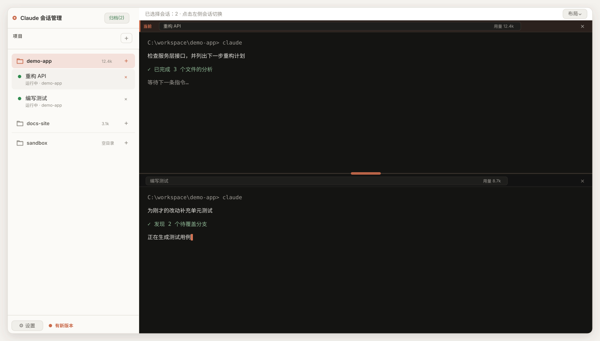

# TheOne

一个程序，管理多个 Agent。TheOne 是 Windows 原生 Claude / Codex 会话管理器：Go/Wails v2、xterm.js 与 ConPTY 组成右侧多会话终端，左侧列表负责分组、折叠、恢复和归档；切换和关闭都在左侧会话列表完成。



> 图片采用应用默认的日间 UI 和「Claude 暖黑」终端主题；其中的项目名、路径和会话内容均为演示数据，不对应任何真实项目。

## 功能

- 多会话 ConPTY 终端：会话后台保持运行，切换互不关闭；支持恢复、新建、重命名、归档和关闭。
- 项目分组的 `+` 可选择新建 Claude 或 Codex，列表显示来源，两种会话可混合分屏。新建 Codex 会话在原生历史确认保存后自动绑定正式身份、更新标题并记忆打开状态，重启后使用原生 `resume` 恢复；尚未发送消息的空会话显示等待保存。
- 顶部 Claude / Codex 图标按钮可以独立筛选历史，默认同时显示，至少保留一种来源；选择保存在固定 AppData 的 `preferences.json`。已打开的会话仍保留入口，关闭后遵循筛选；归档列表和计数跟随筛选。只使用某一种 agent 时，未选中且无打开/待恢复会话的来源不读取历史。
- 会话左侧的产品图标同时显示状态：未打开为灰色，已打开的 Claude 为橙色、Codex 为蓝色；执行中使用绿色产品图标缓慢顺时针旋转，每 6 秒一圈，系统启用减少动态效果时保持静止。等待、失败、中断、完成和未读继续使用原有状态标记与动画。
- Windows 任务栏在任一 Claude/Codex 会话等待权限批准或用户输入时，优先显示红色叹号角标；等待解除或会话关闭后恢复「已完成、尚未查看」的数量角标，没有未查看完成会话时隐藏。完成数量按会话身份去重，查看或主动关闭后减少；窗口失焦或最小化时完成仍会计入，失败、中断、等待审批及普通会话关闭不算任务完成；数字 1–9，更多显示 9+。角标随本次应用运行记录，重启清零。
- 本应用打开的 Codex 终端支持实时任务状态和会话 Token 用量。状态区分执行中、等待审批/输入、失败、中断与断线；只有官方成功完成事件触发完成提示。用量展示会话累计和最近请求的输入、缓存读取/写入、输出与思考 Token。
- 工作区顶部显示当前活动会话对应 Agent 的订阅额度圆环，分屏时跟随窗格焦点切换：蓝色为 5 小时已用额度、橙色为周已用额度，灰色表示未使用额度，数字显示剩余百分比；只有一个额度窗口时使用单环。彩色弧线从 12 点沿顺时针增长，表示已使用部分；每个环的参考刻度表示按周期时间均匀使用时彩色弧线应到的位置，悬停或点击可查看参考百分比。点击查看窗口名称、重置时间与刷新按钮。额度属于 CLI 当前登录账户，和会话 Token 累计独立；无法读取时显示「—」，刷新失败可显示带标记的上次读数。
- 明确确认使用 API 方式后，暂停该 Agent 的自动额度查询，保留会话 Token 统计和手动刷新入口；切换到订阅登录后，点击「刷新额度」重新识别并恢复自动刷新。临时失败、未登录或无法确认登录方式不会被当成 API 模式停查。
- Claude/Codex 的额度自动刷新统一为每 15 分钟一次，失败后的自动重试同样按 15 分钟间隔；点击「刷新额度」可手动刷新，不受自动刷新间隔限制，保留 30 秒的接口最小查询间隔。
- 重命名同步到 Claude/Codex 原生会话：Claude 使用内嵌官方 SDK 的离线 `renameSession`（需要 Node.js 18+），Codex 使用 app-server `thread/name/set`。归档仍使用本应用的隐藏状态，永久删除和原生归档/取消归档尚未接入。实现与依赖说明见 [原生重命名](docs/native-rename.md)。
- 会话按工作目录分组；折叠、全局眼睛筛选、完成徽标、未读提示和完成动画保持独立。
- 采用均衡布局：侧栏默认 280px，可拖动调整到 220–360px 或一键收起，宽度和收起状态保存在固定 AppData 设置中。会话保留名称与时间两行，项目添加和新建入口常驻显示。
- 左侧搜索同时匹配项目目录和会话名称，「已打开」按钮只显示存活终端。搜索结果自动展开，搜索与导航筛选不影响后台任务、窗格切换或重启恢复；归档通过独立面板搜索和恢复。
- 顶部工作区工具栏显示当前项目、目录和布局切换；窗格标题栏显示 Agent 图标、Agent · 项目名 · 会话标题、Token 总量和移出按钮，悬停可查看完整路径；下拉选择已在其他窗格显示的会话时，两边交换位置，焦点留在操作窗格。当前焦点以边框表示。移出窗格仍保持会话打开，真正关闭仍从左侧会话行操作。
- 左下角「⚙ 设置」管理日间/夜间 UI 主题、8 套终端主题和底层 Shell（cmd / pwsh）。
- 终端支持单屏、上下/左右双屏、三分屏和四分屏；分屏控制线可拖动调整比例，清空窗格时会按布局自动收缩。
- 设置中的「更新」只检查 GitHub Releases 的 `v*-wails` 正式版本；应用每天自动检查一次，也可手动查看更新说明、显示下载进度并自动替换重启。
- 应用数据统一保存到 `%LOCALAPPDATA%\ClaudeSessionManager`，不受 exe 文件名或所在目录影响。收藏、项目、Shell、打开会话和界面设置分别保存为 JSON；主题、配色、字号、布局和更新检查日期保存在 `preferences.json`，WebView 数据位于 `WebView2` 子目录。旧目录的数据不会自动导入或删除。

## 快速使用

1. 从 [Releases](https://github.com/gp-alex-chen/claude-session-manager/releases/latest) 下载最新的 `TheOne.exe`，并确保 Windows 已安装 WebView2 Runtime。
2. 确认要使用的 `claude` / `codex` CLI 已安装、登录并加入 `PATH`，然后双击运行 exe。只安装 Claude 也可使用，选择未安装的 Codex 时会显示启动失败。
3. 点击左侧「项目」旁的 `+` 添加工作目录；点击目录分组的 `+`，选择 Claude 或 Codex，即可在该目录下新建终端。已有会话会按工作目录自动分组。同名目录会在标题后追加最短的可区分父路径，必要时包含盘符或网络服务器名；悬停查看完整路径。
4. 点击右侧工作区工具栏的「布局」选择单屏、双屏、三分屏或四分屏；分屏后的控制线可以左右或上下拖动。工具栏左侧按钮可收起和展开侧栏。
5. 右键目录分组可收藏项目或直接打开文件夹；左下角「⚙ 设置」可调整外观、终端主题、Shell 和更新选项。

## 界面说明

### 项目和会话列表

- 「眼睛」按钮只影响已经折叠的目录：开启时保留其中正在运行的会话，关闭时折叠目录中的会话全部隐藏；展开目录不受影响。
- 文件夹图标表示目录分组，展开/折叠会切换打开和关闭的文件夹图标；图标变为陶土橙表示该目录已收藏并置顶。
- 目录分组右侧的 `+` 会在该目录下新建会话；右键目录分组可以收藏/取消收藏，或直接打开 Windows 文件夹。

### 会话状态图例

| 图标或表现 | 含义 |
| --- | --- |
| 绿色动态波形 `▁▂▃▅▇` | 正在执行任务。波形会持续变化，表示 agent 正在工作。 |
| 橙色 `⚠` | 等待权限批准，需要回到该会话处理授权。 |
| 橙色 `●` | 后台待命或排队，当前没有正在执行的任务。 |
| 绿色 `◉` | 交互会话已打开，正在等待输入。 |
| 灰色 `●` | 未运行，会话当前没有对应的终端进程。 |
| `─` 短暂出现，随后变为强调色 `●` | 任务刚刚完成；如果当时没有查看该会话，圆点会保留为“已完成 · 未读”，点击会话即可查看并清除未读提示。 |

### 终端和分屏

- 状态栏的「布局」可以切换单屏、上下/左右双屏、三分屏和四分屏。
- 分屏中间的控制线可以拖动，调整左右宽度或上下高度；当前获得焦点的窗格会显示「当前」标记。
- 窗格下拉框可以把一个正在运行的会话放入该窗格；窗格右侧的 `×` 只清空窗格并按布局收缩，不会关闭会话进程。
- 顶部「归档(n)」用于查看和恢复已归档的会话；左下角「有新版本」提示表示发现了可用更新。

## 亮点

- 多会话并行：会话在后台保持运行，切换项目不会关闭正在执行的任务。
- 灵活分屏：按工作流选择布局，拖动控制线分配空间，适合同时观察多个 Claude 会话。
- 项目管理轻量直接：目录可收藏并置顶、快速打开文件夹，空目录也能提前准备工作区。
- 状态与体验完整：支持会话恢复、归档、主题切换、Shell 选择和新版本提示。

## 前置条件

- Windows 10/11 与 WebView2 Runtime。
- Go 1.25、Node.js 22/npm。
- Claude CLI 在 `PATH` 中；真实 agents/ConPTY 集成测试也需要它。
- Claude 订阅额度使用官方 Agent SDK `0.3.293` 的实验性结构化额度控制接口，需要 Node.js 18+ 与兼容的原生 CLI（验证版本 `2.1.295`）。不兼容、未登录或 API key 等不提供订阅额度的登录方式会显示不可用。Codex 额度使用 app-server `account/read` / `account/rateLimits/read`，不读取认证文件或私有 HTTP 接口。
- Codex 支持验证于 CLI `0.161.0`，依赖 `app-server`、`--remote` 和 `--remote-auth-token-env`；支持 PATH 原生 exe 与官方 npm 安装布局。Codex 终端复用用户自己的登录、模型和权限配置，应用不自动绕过审批。每个终端连接到本应用管理的独立 app-server，本地转发器只观察官方状态/用量事件，所有交互和审批仍由原生 TUI 处理。历史读取使用另一独立 stdio app-server，仅查询元数据。
- 普通构建不要求安装 Wails CLI：仓库提交了 `frontend/wailsjs` 的兼容 wrapper，后端可直接用 `go build`。

## 目录

```
main.go                         Wails composition root：embed、启动、绑定
internal/app/                   Wails App 绑定与业务编排
internal/terminal/              ConPTY 生命周期、输入输出、token 管理
internal/state/                 favorites/open-sessions/settings 原子状态存储
internal/session/               ~/.claude/projects 会话解析
internal/agent/                 claude agents watcher 与调试日志
internal/provider/              agent 注册、统一身份与 Claude/Codex 适配器
internal/notify/                Windows 提示音
internal/updater/               GitHub 更新检查、下载、自替换
frontend/src/app/                应用 bootstrap 与统一生命周期
frontend/src/terminal/           终端 controller
frontend/src/agents/             agent 状态 controller
frontend/src/sessions/           会话 controller、配对 helper、列表 view
frontend/src/settings/           设置 controller
frontend/src/updates/            更新 controller
frontend/src/state/              前端共享 state
frontend/src/styles/             themes/base/sidebar/menus/terminal 分层 CSS
frontend/src/themes/             终端主题 catalog
frontend/src/api/backend.js     前端唯一 Wails wrapper 边界
frontend/wailsjs/                提交到仓库的 Wails 兼容绑定 wrapper
frontend/test/                   Node 内置测试（纯逻辑与 fake DOM）
assets/                          源资源；syso 留在 main 包目录
docs/maintenance.md              维护、测试与扩展手册
docs/releases/                  按 tag 保存的中文更新说明
```

## 可复现开发命令

```powershell
cd frontend
npm ci
npm test
npm run build
cd ..
go test ./...
go vet ./...
New-Item -ItemType Directory -Force .codex-build | Out-Null
go build -tags "webview2 production" `
  -ldflags "-s -w -H windowsgui -X github.com/gp-alex-chen/claude-session-manager/internal/app.Version=dev" `
  -o .codex-build/TheOne-dev.exe .
```

`-H windowsgui` 生成 GUI 子系统版本；调试时可去掉它。普通构建与 CI 发布版默认不写应用调试日志；需要本地日志诊断时，显式使用 `-tags "webview2 production debuglog"` 构建，日志写入应用数据目录的 `agents-debug.log`。发布构建不添加 `debuglog` 标签。普通 Go 单元测试使用 fake、临时目录和依赖注入，不需要本机 Claude 会话。真实环境测试明确使用 integration tag：

```powershell
go test -tags integration ./internal/terminal
go test -tags integration ./internal/agent
```

这两组 Windows 集成测试分别依赖真实 ConPTY 和 `claude agents --json`。

## 数据流与状态文件

```
ConPTY 输出 -> base64 -> term:data(token, b64) -> 对应 xterm
键盘输入 -> UTF-8/base64 -> TermWrite -> ConPTY
窗口 resize -> FitAddon -> TermResize -> ConPTY
agent watcher（约 1~2s） -> agents:update -> 徽标/未读/完成提示
前端每 30s GetAgents 兜底 -> 使用后端 watcher 缓存
```

- `favorites.json` 保存会话 ID、历史显示别名和隐藏 ID；支持原生重命名的 agent 使用原生名称，历史别名不再覆盖它。
- `open-sessions.json` 保存关闭应用时仍打开的历史会话键；旧 Claude ID 原样保留，Codex 使用 `codex:<UUID>`，传给 CLI 的仍是原始 UUID。临时新 Codex 终端不写入恢复清单。
- `settings.json` 保存 `cmd`/`pwsh` 选择。
- `projects.json` 保存项目工作目录数组和收藏目录数组，格式为 `{"dirs":["..."],"favorites":["..."]}`；`favorites` 可省略以兼容旧文件。项目只是用户选择并保存的目录字符串，不包含额外的项目数据。
- 写入使用同一 Store 锁、项目文件的跨进程锁和临时文件替换；读取损坏或包含空白目录项时返回安全默认并记录诊断。

项目目录由 Wails App 提供 `ListProjects`、`ChooseProjectDir`、`AddProject`、`OpenFolder`、`ListProjectFavorites`、`SetProjectFavorite` 和兼容性的 `DeleteProject`。目录选择器取消时不保存；添加目录会按规范化完整路径去重，重复添加幂等成功。删除只移除 `projects.json` 中的配置，不删除真实目录、历史会话或终端，并同步移除该目录的收藏；当前界面不提供删除按钮。重启时保存目录和收藏会从 `projects.json` 恢复并合并到会话列表，即使目录当前没有会话或后来已不存在也继续显示；右键任意目录分组都可添加/取消收藏，收藏目录按最近收藏顺序置顶并高亮文件夹图标，目录分组 `+` 复用 `StartNew(dir)`，右键目录分组可直接打开 Windows 文件资源管理器。会话恢复仍以会话自身保存的 `dir` 为准。

项目相关的确定性覆盖包括：项目和收藏持久化往返、收藏最新置顶、损坏或缺失文件的安全读取、规范化重复目录、单行项目区域、空目录分组、添加/取消/后端删除边界、目录分组 `+` 的 `StartNew(dir)` 转发、项目和会话自动生成目录的右键收藏及打开文件夹、失效目录启动失败不产生 pending 会话，以及重启恢复时使用会话自身目录。绑定集合和参数转发由 frontend binding test 校验。

可单独运行项目相关检查：

```powershell
cd frontend
node --test test/app-bootstrap.test.js test/backend-bindings.test.js test/projects-controller.test.js test/session-controller.test.js
node --check src/app/bootstrap.js
node --check src/sessions/controller.js
node --check src/sessions/view.js
cd ..
go test ./internal/state ./internal/app
git diff --check
```

## 发布与更新

CI 对 `v*-wails` tag 构建 `TheOne.exe` 并发布 GitHub Release，同时保留 `claude-terminal.exe` 同内容兼容文件供旧版自动更新；`-pre`/`-rc` tag 标为预发布。手动触发可构建 artifact，但不会创建 release。应用更新只选择 `v*-wails` 正式版本，版本通过 `internal/app.Version` 注入。打 tag 前必须提交同名的 `docs/releases/<tag>.md` 中文说明；缺少该文件时 CI 不会发布 Release。

```powershell
$tag = Read-Host '输入新的正式版 tag（例如 v0.11-wails）'
if ($tag -notmatch '^v\d+(?:\.\d+){1,2}-wails$') { throw 'tag 格式错误' }
if (git tag --list $tag) { throw 'tag 已存在' }
if (-not (Test-Path "docs/releases/$tag.md")) { throw '缺少中文更新说明' }
git tag -a $tag -m $tag
git push origin $tag
```

更新会核对 GitHub Release 资产的 SHA256、下载大小和 PE 头，但目前没有代码签名验证；应用目录必须可写。会话清单保存成功后才会结束 ConPTY，重启后恢复。

## 已知限制

- ConPTY/conhost 可能让 Claude 的 `/theme auto` 误判亮色背景；需要在 Claude 内手动 `/theme light`。
- `Ctrl+V`、`Ctrl+Shift+V`、`Shift+Insert` 粘贴；`Ctrl+Enter` 发送 LF。未读状态只保存在内存中。
- pwsh 需要 PowerShell 7 的 `pwsh` 在 PATH；不可用时后端会回退 cmd 并记录诊断。
- Codex 新建空会话虽然已有原生 ID，但可能尚无可恢复记录；发送消息并由官方历史确认保存后才自动加入恢复清单。原生历史查询或本地保存失败时继续等待确认，不使用目录 FIFO 猜测身份。恢复出的终端在原生 TUI 内切换会话后，原会话的终端标识暂被占用；需要先关闭当前终端，再单独恢复原会话。
- Codex 状态只覆盖本应用打开的终端。未完成协议握手或断线时显示「任务状态未知」；软件不会推测外部 Codex 进程的任务状态。
- Codex 用量以实际收到的官方累计快照为准，不解析私有历史文件。CLI `0.161.0` 没有完整历史用量读取接口，恢复旧历史时也未观察到旧用量回放，因此缺少快照时显示暂无数据。关闭终端后仅可保留本次运行内的旧快照，并标为较旧；不把它当成完整账单。项目用量仍只统计 Claude，Codex 请求次数与缓存 5m/1h 细分显示不可用。
- 本地转发器只监听 `127.0.0.1`、使用随机凭据并只接受一个原生 TUI 连接；凭据只进入该终端的子进程环境。关闭分屏窗格仍只清空窗格，关闭终端时关闭它专属的 app-server 和连接，软件不会停止全局共享 daemon。

更多架构约定、并发边界、测试分层和扩展步骤见 [`docs/maintenance.md`](docs/maintenance.md)。
